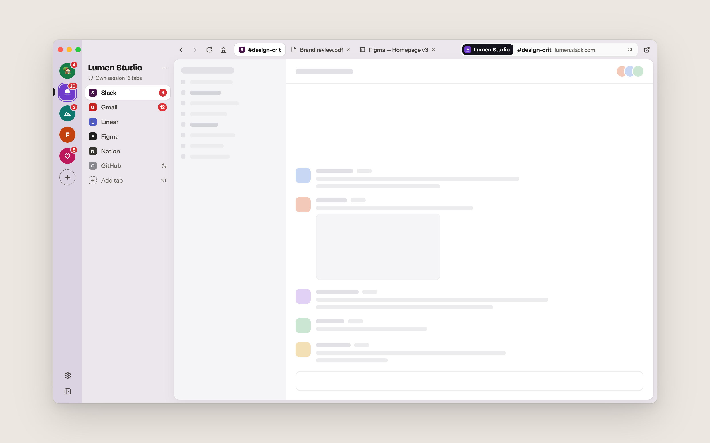
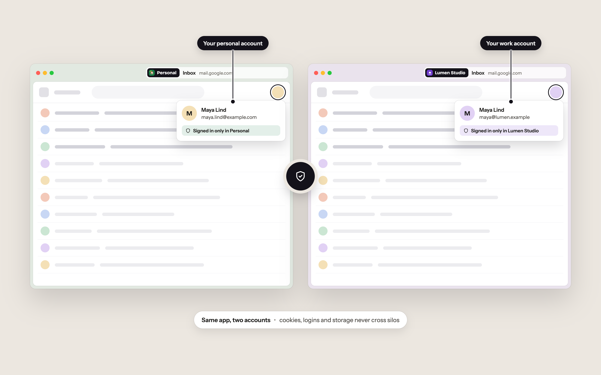
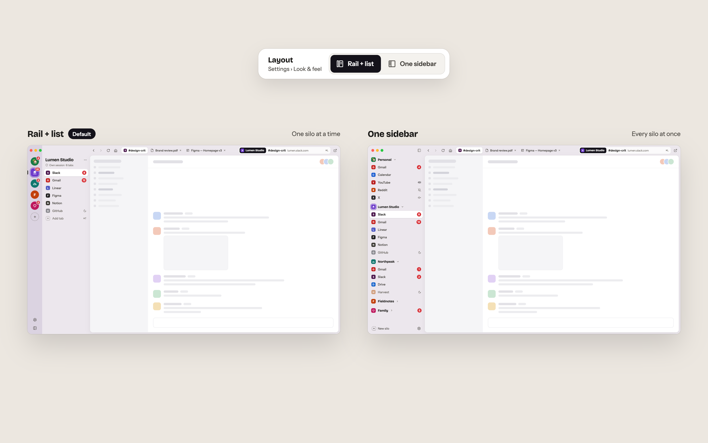
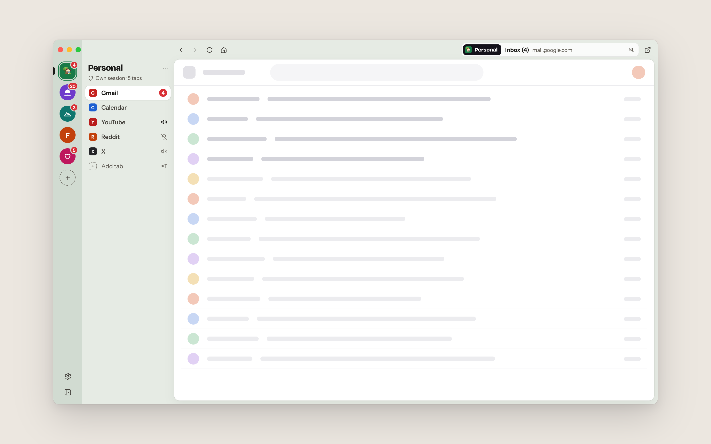
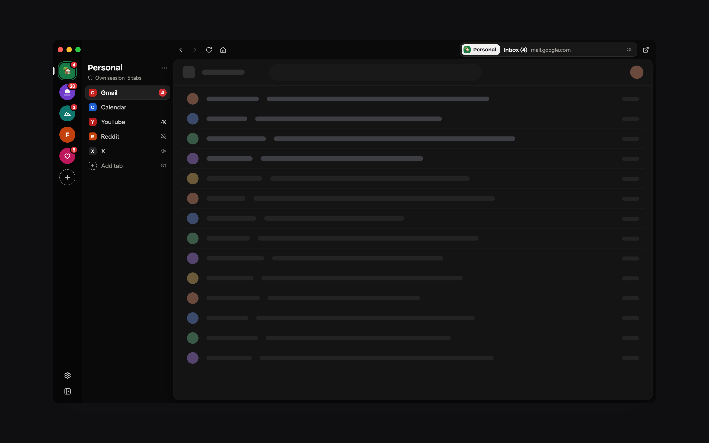
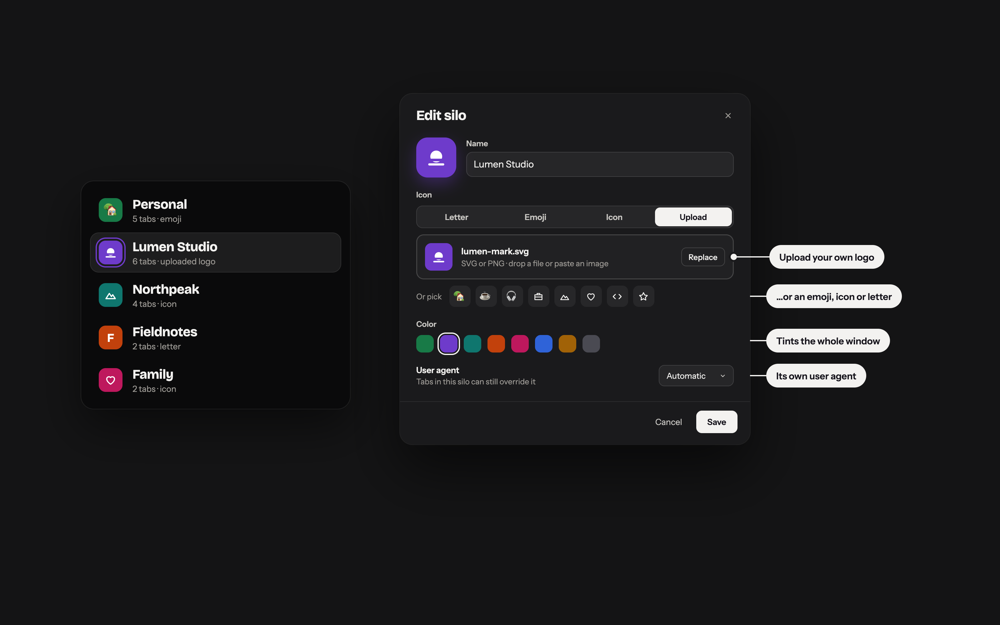
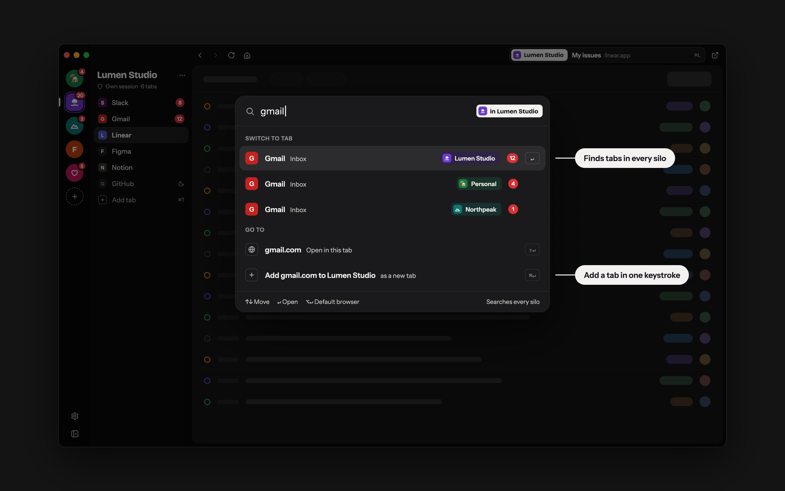
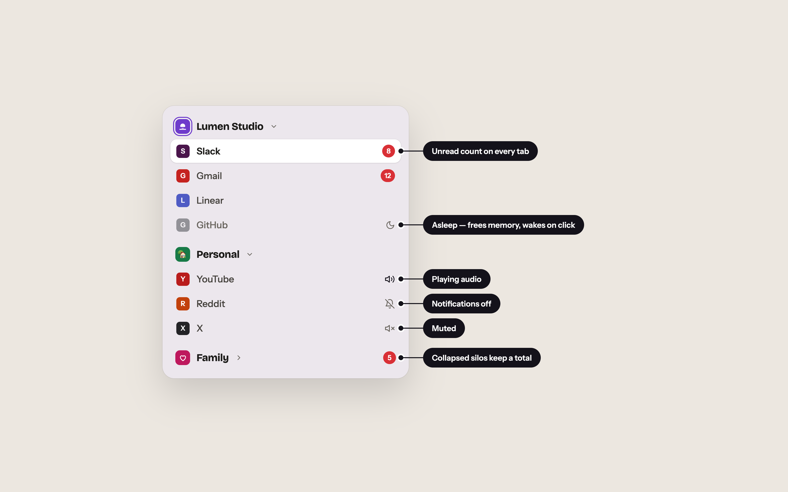
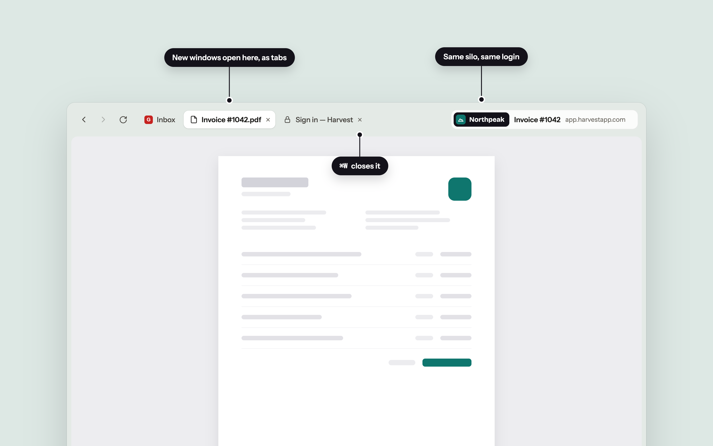

# Silo Browser

A desktop browser that organizes web apps into session-isolated **silos**.

Each silo keeps its own cookies, localStorage and session data — so you can run multiple accounts for the same service side by side. Built with Electron, Vue 3, and TypeScript.



## Isolated sessions

**Two accounts, side by side.** Sign in to the same app in different silos — personal in one, work in another. Nothing leaks between them.



## Two layouts

**Your silos, your layout.** Start with the silo rail — one silo at a time — or switch to a single sidebar that shows every silo at once. Change it any time in Settings.



## Light and dark

**Easy on the eyes.** Light, dark or match your system — then pick your exact shade, from warm stone to pitch black.

<table>
  <tr>
    <th width="50%">Light</th>
    <th width="50%">Dark</th>
  </tr>
  <tr>
    <td></td>
    <td></td>
  </tr>
</table>

## Features

<table>
  <tr>
    <td width="50%" valign="top">
      <b>Make every silo yours.</b><br>
      Upload your own logo or pick an emoji, icon or letter. Choose a color and a user agent for each silo.<br><br>
      
    </td>
    <td width="50%" valign="top">
      <b>Jump anywhere with ⌘L.</b><br>
      Search open tabs across every silo, or type an address and add it as a tab in one keystroke.<br><br>
      
    </td>
  </tr>
  <tr>
    <td width="50%" valign="top">
      <b>See what needs you.</b><br>
      Unread badges on every tab, plus mute, notification controls and auto-sleep for the tabs you’re not using.<br><br>
      
    </td>
    <td width="50%" valign="top">
      <b>Pop-ups stay put.</b><br>
      Links that open new windows land as tabs above the page — in the same silo, with the same login.<br><br>
      
    </td>
  </tr>
</table>

### Everything Silo does

| Feature | Description |
| --- | --- |
| Session-isolated silos | Each silo has its own cookies, localStorage, IndexedDB, and cache. Log into the same site with different accounts across silos. |
| Custom silos | Give each silo a name, a color (it tints the window while you're in it) and an icon: a letter, an emoji, a built-in icon or your own uploaded SVG/PNG logo. |
| Command bar | Press `Cmd/Ctrl+L` to search open tabs across every silo, open an address in the current tab, or add it as a new tab to the current silo. |
| Tab management | Add, edit, delete, and reorder tabs with drag-and-drop. Move tabs between silos. |
| Pop-up tabs | Links that open in new windows stay inside the app as tabs above the page, in the same silo and with the same login. |
| Custom user agent | Set a default user agent, override it per silo, and again per tab. |
| Notification badges | Tabs show an unread count when they receive notifications in the background; collapsed silos show a total. Per-tab notification toggle. |
| Auto-sleep | Tabs can automatically suspend after a period of inactivity to save memory. Configurable per tab (Never / 30 min / 1 hr / 2 hr / 4 hr) with a global default for new tabs in Settings. Tabs set to "Never" stay loaded on startup. |
| Tab mute | Mute audio on any tab. A speaker icon shows when a tab is playing audio. |
| Two sidebar layouts | A silo rail with the selected silo's tabs, or every silo in one list. Both collapse to an icon-only column. |
| Keyboard shortcuts | Quick access to common actions — new tab, new silo, reload, command bar, find in page, switch tabs, and more. |
| Emoji tab icons | Override a tab's favicon with any emoji character. |
| Import / export config | Save your full setup (silos, tabs, settings) to a JSON file and restore it anytime. Logins are never included. |
| Themes | Light, dark, or match your system — then pick one of six light and six dark shades, an accent color, and how strongly the active silo tints the window. |
| Auto-updater | The app checks for updates in the background and prompts you when a new version is ready. |
| Cross-platform | Available for macOS, Windows, and Linux. |

## Why Electron?

| Criteria | Electron | Tauri | CEF |
| --- | --- | --- | --- |
| Session isolation | `session.fromPartition()` | Fragmented — no unified API, platform-specific workarounds | `CefRequestContext` — works but complex cleanup |
| Rendering engine | Chromium everywhere | Different per platform (WKWebView, WebKitGTK, WebView2) | Chromium everywhere |
| Pop-up / OAuth support | Full | Broken — pop-ups blocked regardless of permissions | Full |
| Favicon events | Built-in | Not available — requires JS workaround | Built-in |
| Auto-updater | `electron-updater` | Built-in plugin | Must implement yourself |
| Cross-platform packaging | `electron-builder` | Built-in | Must implement yourself |
| Dev language | TypeScript / Vue | Rust + TypeScript / Vue | C++ or Java |
| Dev iteration speed | Fast | Medium | Slow |

## Development

```bash
# Install dependencies
pnpm install

# Start dev server with HMR
pnpm dev

# Build for production
pnpm build:mac
pnpm build:win
pnpm build:linux
```
